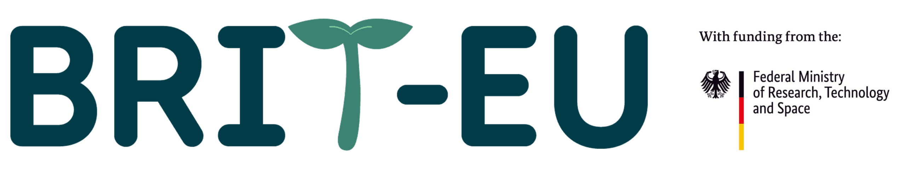
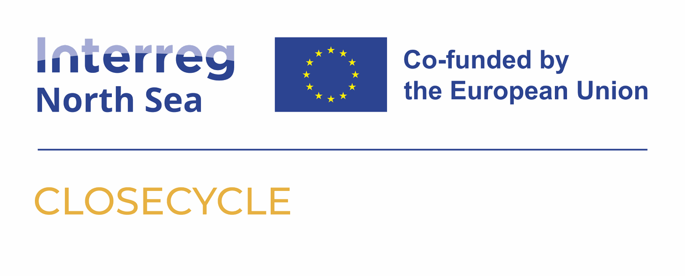
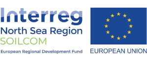
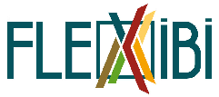

# Bioresource Inventory Tool (BRIT)

BRIT is a browser-based tool, designed to improve the understanding and management of biogenic residue waste streams. 
The tool aims to offer its users a comprehensive view of the entire waste generation, collection, and processing 
landscape using mapping and visualization approaches, as well as interactive scenario development.

## Access

A public instance of this tool is hosted by Hamburg University of Technology and can be accessed at
https://brit.bioresource-tools.net.

This instance contains the data and case studies from the projects FLEXIBI, SOILCOM, CLOSECYCLE and BRIT-EU as well
as other data produced by the BIEM research group.

## Local setup

BRIT runs entirely in Docker. To start a development instance from a fresh
clone, copy the environment template and start the Compose stack:

```sh
cp brit/settings/.env.example brit/settings/.env
docker compose up --build
```

Replace the development placeholders in the new `.env` before starting. On
first start, a one-shot `init` service migrates the database and seeds the
required initial data automatically (equivalent to running
`python manage.py bootstrap_database`), so no database snapshot is needed. To
log in as the admin named by `ADMIN_USERNAME`, set `ADMIN_PASSWORD` in
`brit/settings/.env` before the first start or assign a password afterwards:

```sh
docker compose exec web python manage.py changepassword admin
```

Use `createsuperuser` only for a different admin username. See the
[Developer Guide](docs/02_developer_guide/guidelines.md#local-development) for
details.

BRIT is under constant development. Please feel free to leave any kind of feedback at
[info@bioresource-tools.net](mailto:info@bioresource-tools.net)

## Repository boundaries

This repository is the published open-source BRIT application. Raw data,
production repair scripts, one-off SQL, country-specific ETL clients, deployment
overlays, and agent-local workflows are intentionally kept outside the public app
repository. See
[Repository Boundaries](docs/02_developer_guide/repository_boundaries.md) before
adding helper infrastructure or data-management tooling.

## The BRIT-EU project

[](https://www.compostnetwork.info/brit-eu/)

From December 2024 to May 2026, Hamburg University of Technology (TUHH) and the European Compost Network (ECN)
developed BRIT further in the BRIT-EU project.
The project expanded the household waste collection data model and introduced a contributor submission and review
workflow and the digital Waste Atlas.
Structured data, source references and exports supported comparisons of biowaste collection systems and case
studies in Catalonia, North Rhine-Westphalia, Rhineland-Palatinate, Sweden and South Tyrol.

BRIT-EU was funded through the DATIpilot programme of the German
Federal Ministry of Research, Technology and Space (BMFTR), under grant numbers 03DPS1185A (TUHH) and
03DPS1185B (ECN).

Development and data curation have continued beyond the funded project period.

BRIT-EU website: https://www.compostnetwork.info/brit-eu/

## The CLOSECYCLE project

[](https://www.interregnorthsea.eu/closecycle)

CLOSECYCLE (2024 to 2027) is an Interreg North Sea project, co-funded by the European Union, working towards
Territorial Biorefinery Networks (TBNs) that turn local residual bioresources into useful products.
BRIT forms part of its digital tool package.
The ongoing work includes a revised Materials model for samples, analytical measurements, units, reference bases
and sources; a Processes module linking input and output materials with operating conditions; and mapped showcases
of territorial biorefinery networks.
Partner data and process descriptions are being curated and reviewed.

CLOSECYCLE website: https://www.interregnorthsea.eu/closecycle

## The SOILCOM project



SOILCOM is a project of the Interreg North Sea Region Programme, co-funded by the European Union.
The project focused on sustainable soil management through the utilization of waste streams as a resource for 
custom-made composts. 
Within work package 4 *Waste Streams* of SOILCOM, BRIT was significantly improved, especially the user interface and 
usability across all modules. 
The tool was extended with the *Household Waste Collection* module, which then was applied for the collaborative data 
collection on biowaste collection systems in the North Sea Region.

The state of BRIT at the end of SOILCOM is fixed as release
[Version 0.2 "SOILCOM"](https://github.com/lueho/BRIT/releases/tag/0.2).

SOILCOM website: https://www.northsearegion.eu/soilcom

## The FLEXIBI project



FLEXIBI was an ERA-NET project, which has received funding from the German Ministry of Education and Research (BMBF).
The project studied the potential of residues from agri– and horticulture, gardening and landscaping, as well as from 
post-consumer wood from peri-urban and urban areas as feedstocks for Small-Scale Flexi-Feed Biorefineries (SFB). 
During the project, the proof of concept for BRIT as part of a decision-support-tool was accomplished. 
It was clear that a tool for data collection and inventories could be built as easy to use online-tool, relying on only
open-source libraries. 
The name Bioresource Information Tool was coined and the first prototype was built.

The state of BRIT at the end of FLEXIBI is fixed as release 
[Version 0.1 "FLEXIBI"](https://github.com/lueho/BRIT/releases/tag/0.1).

FLEXIBI website: http://www.flexibi-biorefineries.eu

## The BIEM research group
BIEM is a research group that is dedicated to bioresource management.
It is based at the Institute of Water Resources and Water Supply of Hamburg University of Technology,
at Eißendorfer Str. 40, 21073 Hamburg, Germany.
To find out more about the group and its most recent research, visit https://www.tuhh.de/alt/aww/research/biem.

The BIEM group operates a platform to disseminate the tools, lectures and info
material from the various projects it is involved in: https://www.bioresource-tools.net
