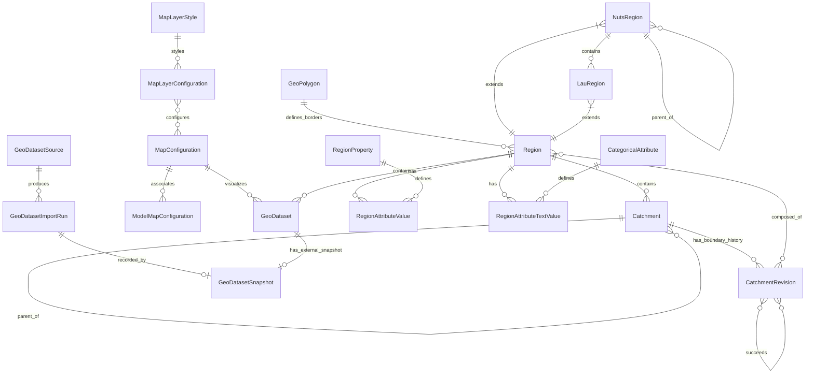

# Maps Module

## Overview
The Maps module is a core component of the Bioresource Inventory Tool (BRIT) that provides geographic data management, visualization, and spatial analysis capabilities. It serves as the foundation for representing spatial information throughout the application, enabling users to visualize bioresources, catchment areas, and other geographic entities.

## Features
- Geographic data representation and management
- Map layer styling and configuration
- Support for administrative boundaries (NUTS and LAU regions)
- Custom region and catchment area definition
- Integration with external geographic datasets
- Spatial attribute management
- Map visualization and interaction

## Models

### Map Configuration
- **MapLayerStyle**: Defines visual styling for map layers (colors, weights, opacity, etc.)
- **MapLayerConfiguration**: Configures how layers are displayed on maps
- **MapConfiguration**: Manages multiple map layers and their settings
- **ModelMapConfiguration**: Associates map configurations with specific models

### Geographic Entities
- **Location**: Represents a point location with optional address
- **GeoPolygon**: Represents a geographic polygon
- **Region**: Represents a geographic region with borders
- **NutsRegion**: Extends Region for NUTS (Nomenclature of Territorial Units for Statistics) regions
- **LauRegion**: Extends Region for LAU (Local Administrative Units) regions
- **Catchment**: Stable identity for a collection catchment
- **CatchmentRevision**: Immutable, effective-dated boundary snapshot for a catchment

### Data Management
- **GeoDataset**: Holds metadata about geographic datasets
- **GeoDatasetSource**: Operator-managed metadata for an external geodata provider (WFS first)
- **GeoDatasetImportRun**: Provenance record for one import recorded against a source
- **GeoDatasetSnapshot**: Links a GeoDataset to the successful import run that produced it
- **RegionProperty**: Defines numeric attributes that can be attached to regions
- **CategoricalAttribute**: Defines categorical attributes for regions
- **RegionAttributeValue**: Attaches numeric values to regions
- **RegionAttributeTextValue**: Attaches text values to regions

## Entity Relationship Diagram

## Versioning catchment boundaries

`Catchment` is the stable identity referenced by collections and collectors.
Its `region` remains a compatibility representation of the current geography;
it is not the historical record. Each authoritative boundary is stored as a
`CatchmentRevision` with a direct geometry snapshot and a half-open effective
period (`effective_from <= date < effective_to`). Published and archived
periods for one catchment cannot overlap.

Published geometry, dates, catchment assignment, and member composition are
immutable. To record a change:

1. Create a private successor revision, preferably with
   `CatchmentRevision.objects.create_from_members(...)` so the geometry is the
   validated union of its LAU/NUTS members.
2. Give it the real effective date, change reason, sources, and its prior
   same-catchment revision as a predecessor.
3. Use the Catchment Revision admin actions to submit and approve it. Approval
   atomically ends and archives the prior revision at the successor's start
   date, then publishes the successor.

For example, if Attendorn entered ZAKO's catchment on 1 January 2024, the
pre-2024 revision remains unchanged and the successor starts on 2024-01-01
with Attendorn among its members. Do not rewrite the earlier geometry.

Annual Waste Atlas maps resolve the revision effective on 31 December of the
selected year. Change maps request a spatial overlay of both selected years;
the response distinguishes stable, added, removed, and reassigned territory
and carries both revision and catchment IDs. The migration creates one
unbounded initial snapshot from each existing georeferenced catchment because
the legacy data does not establish a defensible historical start date.

## Views
The module provides a comprehensive set of views for managing and visualizing geographic data:
- Map views for different types of geographic entities
- CRUD operations for regions, catchments, and other geographic entities
- Layer management views
- Spatial filtering and query views
- GeoJSON API endpoints for map data

## Integration
The Maps module integrates with other BRIT modules:
- Bibliography module for data sources
- Inventories module for spatial representation of inventory data
- Case Studies modules for specialized geographic visualizations
- Layer Manager module for advanced layer management

## Usage
This module is used throughout BRIT to:
- Visualize the spatial distribution of bioresources
- Define and manage catchment areas for data collection
- Represent administrative boundaries
- Attach spatial attributes to geographic entities
- Provide the foundation for spatial analysis and visualization

## Current GeoDataset Registry Workflow

`GeoDataset` is the stable user-facing record for geographic datasets. It now supports both legacy model-backed datasets and local PostGIS table/view-backed datasets through normalized runtime metadata.

### Supported local-relation onboarding flow

#### 1. Prepare a trusted local relation
- Use a plain PostGIS table or trusted database view.
- The relation must have a stable primary-key column and a PostGIS geometry column.
- Prepare joins, transformations, or sensitive-field removal outside the generic runtime, usually in a reviewed view.

#### 2. Register the dataset
- Create a `GeoDataset` with normal metadata such as name, description, region, sources, preview image, and optional map configuration.
- Create or edit its `GeoDatasetRuntimeConfiguration` with:
  - `backend_type=local_relation`
  - schema and relation name
  - geometry column
  - primary-key column
  - optional label field

#### 3. Review and promote columns
- Use runtime introspection to inspect available relation columns.
- Add `GeoDatasetColumnPolicy` rows only for columns that should be exposed.
- Visibility, filtering, search, and export settings are explicit policy decisions; discovered columns are not exposed automatically.

#### 4. Explore through dataset-scoped routes
- Metadata/detail: `/maps/geodatasets/<pk>/`
- Map: `/maps/geodatasets/<pk>/map/`
- Table: `/maps/geodatasets/<pk>/table/`
- Feature detail: `/maps/geodatasets/<pk>/features/<feature_pk>/`
- GeoJSON: `/maps/geodatasets/<pk>/features.geojson`

The local-relation runtime supports visible-column table/detail output, filtering on explicitly filterable columns, bounded reads, single-feature lookup by configured primary key, and GeoJSON from the configured geometry column.

Filter controls follow the column's database type:

- booleans: Yes/No select (`?col=true`);
- numeric columns: min/max inputs (`?col_min=1&col_max=5`); integer columns with at most 100 distinct values use a multi-select instead;
- dates and timestamps: date min/max inputs, compared by calendar date;
- text with at most 100 distinct values: searchable multi-select (`?col=a&col=b`);
- text with more distinct values: multi-select that autocompletes from `/maps/geodatasets/<pk>/filter-options/<column>/?q=...`.

Invalid typed values return HTTP 400.

### Compatibility paths

Some existing datasets still use model-backed compatibility metadata:

- `model_name`
- `runtime_model_name`
- `features_api_basename`
- `ModelMapConfiguration`
- model-specific GeoJSON/detail/summary API routes

These paths remain for existing Django-model datasets and source-domain maps. New ordinary local table/view onboarding should prefer the `local_relation` runtime path unless custom domain behavior is genuinely required.

### External sources and versioned snapshots

`GeoDatasetSource` is operator-managed metadata about an external provider
endpoint (WFS first): slug, endpoint URL, feature type, attribution, licence
URL and a protected link to a `bibliography.Source`. `is_enabled` marks a
source usable but never schedules anything by itself.

`GeoDatasetImportRun` records one import attempt against a source. On insert
it captures `source_configuration` — the persisted endpoint, feature type,
licence, attribution and bibliography link — so later source edits cannot
rewrite a run's provenance. Runs move `running → succeeded|failed` with
consistent finish timestamps and error messages, enforced by model validation
in `save()` and database check constraints. Source link, captured
configuration, extraction specification and start time are frozen once
recorded; a finished run is immutable. `extraction_specification` is an
opaque metadata object, not executable configuration. Freezing is enforced by
normal model saves and the admin — raw SQL or `QuerySet.update()` bypass it.

`GeoDatasetSnapshot` links an existing `GeoDataset` one-to-one to the
successful import run that produced it (`dataset.external_snapshot`,
`run.snapshot`). The dataset must resolve a valid `local_relation` runtime
configuration; the snapshot does not inspect or create the physical relation.
Link identity is frozen after creation and `PROTECT` on both sides keeps the
historical chain intact under ordinary deletes.

Operator flow:

1. Register the provider as a `GeoDatasetSource` (metadata only).
2. Record a `GeoDatasetImportRun` and mark it `succeeded` with its finish
   timestamp once the data exists locally.
3. Create the `GeoDatasetSnapshot` linking that run to the `local_relation`
   `GeoDataset` that serves the imported data.

Non-goals for this foundation slice: no fetching, importing or scheduling; no
raw-data tables or row ingestion; no physical relation immutability; no
automatic inventory compatibility or dataset publication. Acquisition and
provider mapping code live outside the registry.

### Current limits

- Federation, automated refresh and data version pinning, exports, summaries, schema-drift checks, and inventory version pinning are later roadmap phases; physical relation immutability is not part of the source/run/snapshot foundation.
- The generic runtime does not accept arbitrary SQL or user-defined expressions.
- A production pilot should still validate the full operator workflow before broad use.

### Notes for developers

- The authoritative roadmap is tracked in [issue #85](https://github.com/lueho/BRIT/issues/85); WFS-first external sources and versioned snapshots land there in slices.
- Keep ingestion, transformation, and harmonization logic outside the generic registry runtime unless the roadmap explicitly moves that boundary.
